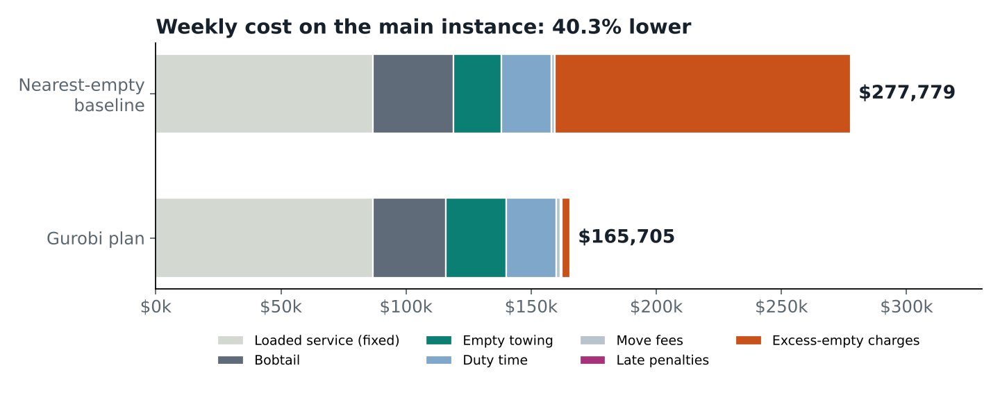
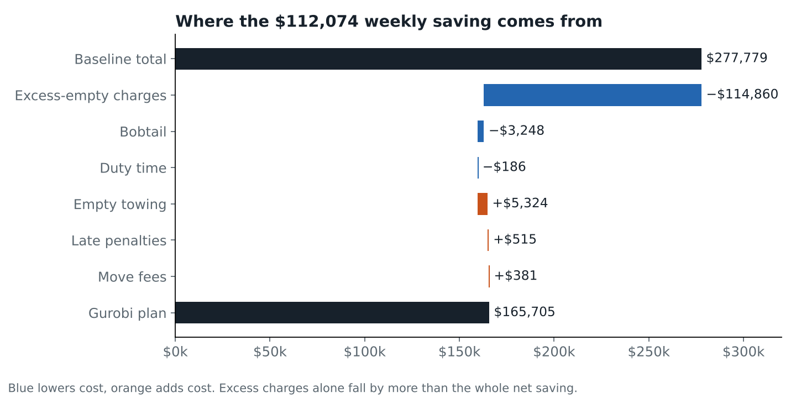
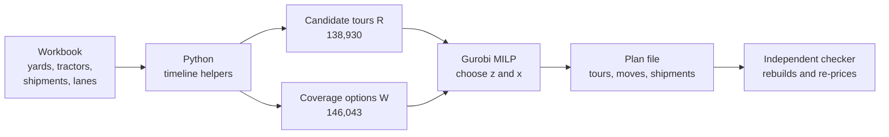

# Empty Trailer Repositioning

**A mixed-integer optimization model that plans a week of empty-trailer moves for a freight network and cuts total cost by 40% against a dispatcher-style rule.**


Team project for MGSC 404 (Foundations of Decision Analytics), McGill University, Fall 2026.

---

## Results at a glance

| | Nearest-empty baseline | Our model | Change |
|---|---:|---:|---:|
| Total weekly cost | $277,779 | **$165,705** | **−$112,074 (−40.3%)** |
| Repositioning cost (excl. fixed carrier charges) | $190,964 | $78,890 | −58.7% |
| Trailer-hours above yard allowance | 5,919 | 176 | −97% |
| Shipments ready on time | 168 / 168 | 164 / 168 | 4 late, 6 h total |
| Empty moves / tractor shifts | 76 / 76 | 100 / 78 | 22 two-move shifts |

Solved to proven optimality (gap 0) over 138,930 candidate tours: **377,133 variables, 182,669 constraints, under 5 seconds** in Gurobi. An independent checker rebuilt the plan from scratch and reproduced the total to the cent.

<p align="center"></p>
<p align="center"></p>

**The insight:** the money is not in covering shipments more cleverly. It is in yard balance. Freight flows one way, so empties pile up at stores and each one above the yard's allowance costs $20 an hour. A rule that only looks at the next shipment never moves them. The model does, because an empty left for more than about 37 hours costs more than moving it.

---

## The business problem

A carrier runs one shared pool of 96 empty trailers across 24 yards and 4 tractor depots. Over a 10-day horizon, 168 loaded shipments each need an empty trailer waiting at their origin by a deadline. 32 tractor-driver pairs reposition empties, one trailer at a time, inside their shifts, driving and duty limits, and the yards' opening hours.

The planner decides **which empties to move, when, and with which tractor** so that every shipment is served at minimum total cost:

- bobtail (driving without a trailer) and empty-towing kilometres, duty hours and move fees
- $60–$120 per hour when an empty is ready late
- $20 per trailer-hour for empties above a yard's allowance
- hard physical yard capacity that can never be exceeded

## How it works



The key design choice is to **put time in the parameters and choices in the variables**. Python walks every possible tractor-day forward on the clock (waiting for closed yards, checking shift, drive and duty limits) and keeps only legal tours, each with its exact cost. It does the same for every way a shipment could get its empty, including late options with their later downstream release. Gurobi then only answers yes or no for each candidate. As a result:

- no big-M constraints anywhere, so the LP relaxation is tight;
- Gurobi's root relaxation was already integral: 1 branch-and-bound node, gap 0;
- lateness is not a variable, it is a property of the option chosen.

## The model

**Decision variables**

| Variable | Meaning |
|---|---|
| $z_r \in \{0,1\}$ | drive candidate tour $r$ (fixes tractor, day, which empties move and every clock time) |
| $x_w \in \{0,1\}$ | cover shipment $j$ with option $w$ (own stock at the origin, or the empty of one specific move) |
| $U_{g,t}, P_{g,t}, L_{g,t} \ge 0$ | usable empties, physical empties and loaded trailers in yard $g$ during 15-minute step $t$ |
| $E_{g,t} \ge 0$ | empties above the allowance |

**Objective**

$$\min \sum_{r} c_r z_r + \sum_{w} lc_w x_w + \sum_{g,t} 0.25\,\beta_g E_{g,t} + K$$

**Constraints**

| # | Constraint | Rule it enforces |
|---|---|---|
| 1 | $\sum_{w \in W_j} x_w = 1$ | every shipment covered exactly once |
| 2 | $\sum_{w \in W^m} x_w \le z_{r(m)}$ | a moved empty serves at most one shipment, and only if its tour runs |
| 3 | $\sum_{r \in R_{k,d}} z_r \le 1$ | one shift per tractor per day |
| 4 | $U_{g,t} = U_{g,t-1} + \Delta U_{g,t}$, $U \ge 0$ | no trailer is used or promised before it is there |
| 5 | $P_{g,t} = P_{g,t-1} + \Delta P_{g,t}$ | physical empties, the count the allowance limits |
| 6 | $L_{g,t} = L_{g,t-1} + \Delta L_{g,t}$ | loaded trailers still take yard space |
| 7 | $P_{g,t} + L_{g,t} \le cap_g$ | hard yard capacity |
| 8 | $E_{g,t} \ge P_{g,t} - allow_g$ | excess above allowance, priced in the objective (max linearization) |

Constraints 4 to 6 are time-indexed inventory balances over 960 quarter-hour steps. Every possible hook, drop, loading and release is pre-written into them multiplied by the 0/1 variable that switches it on, so the model needs no conditional logic. The full formulation is in the [report](docs/report.pdf).

## Verification

A separate checker notebook reads only the raw workbook and the exported plan, shares no code with the model, and rebuilds every tractor timeline, every trailer's location and every yard count from scratch. It accepted the plan and recomputed $165,704.78 to the cent. It also passes 10 deliberately broken plans, for example:

- a late empty with the penalty charged correctly: **accepted** (lateness is allowed at a price)
- the same late empty with the downstream release left unchanged: **rejected**
- 16 extra trailers parked in one yard with the excess "paid": **rejected**, capacity is hard
- a trailer hooked at a yard where it is not: **rejected**

## What-if analysis

A MIP has no shadow prices, so sensitivity was measured by changing one input, re-solving, and pricing each new plan at the real rates.

| Scenario | Moves | Late hours | Excess trailer-h | Weekly cost vs base |
|---|---:|---:|---:|---:|
| Base plan | 100 | 6.0 | 176.25 | $165,705 |
| Excess rate × 0 (ignored) | 59 | 36.75 | 5,841.25 | +$91,185 |
| Excess rate × 2 | 100 | 4.75 | 137.25 | +$251 |
| Late rates × 0.5 | 94 | 37.0 | 221.25 | +$755 |
| Late rates × 2 | 101 | 0.5 | 176.0 | +$364 |

The plan is stable around the current rates, and near-perfect service costs only $364 more a week.

## Recommendations

1. **Plan empties around yard balance, not only around shipments.** Clearing surplus empties from the small-allowance stores removes almost all of the $118,385 excess bill.
2. **Reuse empties already in place and chain moves.** 22 shifts carry two empties, cutting bobtail by 2,945 km.
3. **Set the late rate to the service level you want.** Lateness is a dial, not a constraint.

**Limits:** one known week with exact travel times (a live operation would re-solve on a rolling horizon), and the optimum is over the generated candidate tours, so the reported saving is conservative.

## Repository structure

```
.
├── 01_model.ipynb        data → candidate tours → Gurobi model → plan, penalty analysis, baseline
├── 02_checker.ipynb      independent feasibility checker and 10 broken-plan tests
├── data/                 project2_main.xlsx, project2_simplified.xlsx
├── results/              plan and baseline Excel files are written here
└── docs/
    ├── report.pdf        full formulation, results and appendices
    ├── presentation.pdf  slide deck
    └── assets/           README charts
```

## Run it

```bash
pip install -r requirements.txt
jupyter notebook 01_model.ipynb      # then 02_checker.ipynb
```

Gurobi needs a full licence (free for students through the Gurobi academic program): the pip licence is limited to 2,000 variables and this model has 377,133. Building the candidate tours takes about two minutes; the solve takes seconds. The notebooks are saved with their outputs, so the results can be read without running anything.

## Team

Group 4: Micah Green, Henry Huang, Michael Raposo, Sabina Frankova, Elena Hanusova.

**My role (Henry Huang):** built the candidate-tour generator (the module that turns raw yards, lanes, shifts and opening hours into 138,930 legal, priced tractor-days), led the baseline comparison and cost analysis, wrote the results and recommendations, and edited the final report.

## Acknowledgements

Course project for MGSC 404, Desautels Faculty of Management, McGill University. The datasets were provided for the course.
